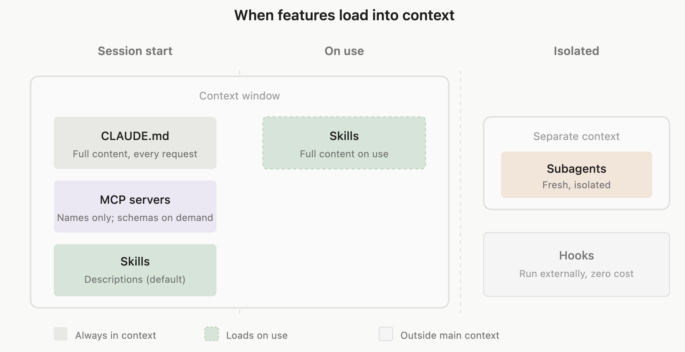

# 1. Точная настройка

Для начала пройдемся по базе - как настраивать Claude Code и ему подобных. Если вы все знаете, можно скипать. 
Эта информация также актуальна и для других агентов (Codex, Opencode, Pi и тд), так как большая часть настроек у них общая, а то, что различается, легко адаптируется.

## TL;DR

Всю настройку (системный промпт, скиллы, правила и тд) можно и нужно делать через агента, просто попросив его.

Кратко про каждый механизм:

| Механизм | Зачем | Когда попадает в контекст |
| --- | --- | --- |
| `CLAUDE.md` | правила, которые агент должен помнить всегда | целиком, в каждой сессии |
| Rules | те же правила, но разложенные по темам и папкам | всегда или когда агент трогает нужные файлы |
| Skills | инструкции под конкретную задачу: деплой, ревью, релиз | в сессии только описание, текст - при вызове |
| Hooks | скрипт, который срабатывает на событие, без участия модели | никогда, работает снаружи |
| MCP | доступ к внешним системам: база, трекер, браузер | названия инструментов, схемы - когда понадобились |
| Субагенты | отдельный агент под задачу со своим контекстом | в основной контекст попадает только итог |
| Settings | права, хуки, переменные окружения | никогда, это конфиг самого Claude Code |



*Рис. 1. Когда механизмы попадают в контекст (схема из документации Claude Code).*

## CLAUDE.md (AGENTS.md)

Это основной файл с настройками агента. По сути, обычный `.md`-файл с системным промптом, который агент кладет себе в контекст в начале каждой сессии. Пихать туда можно все, что угодно, но лучше прислушаться к советам Anthropic/OpenAI и задавать промпт по правилам.  

`CLAUDE.md` - файл для Claude Code, `AGENTS.md` - открытый стандарт для всех остальных агентов типа Codex, Gemini, Opencode и тд (с недавних пор Claude Code принимает его тоже).

Делится на несколько уровней:
1) `~/.claude/CLAUDE.md` - пользовательский. Этот файл подтягивается в начале каждой сессии во всех проектах пользователя, тут задаются общие настройки для всех проектов: стиль общения, язык ответов, свои привычки в коде, любимые инструменты (например, `uv` вместо `pip`), что агенту нельзя делать без спроса (коммитить, пушить, удалять).
2) `<proj>/CLAUDE.md` - проектный. Этот файл подтягивается только в сессии проекта, тут задаются проектные правила (обзор проекта, стек, стиль кода, специфичные правила и тд.)

Файлы не перекрывают друг друга, а складываются: агент видит все сразу. Еще можно положить `CLAUDE.md` в подпапку, он подтянется, когда агент полезет в файлы этой папки.

Пример проектного файла из доки:

```markdown
# Commands
- Install: pnpm install
- Run one test file: pnpm vitest run path/to/file.test.ts
- Typecheck: pnpm tsc --noEmit

# Conventions
- Use the error helpers in src/lib/errors.ts, never throw raw strings
- src/legacy/ is still live but don't copy its patterns into new code

# Gotchas
- Integration tests need DATABASE_URL set, see .env.example
```

AGENTS.md предлагает похожий набор разделов: обзор проекта, сборка и тесты, стиль кода, тестирование, безопасность, правила PR.

Правила написания:
1) **Пиши только то, чего агент не узнает из кода**. 
   Архитектуру и структуру папок агент прочитает сам, а договоренность команды, которой нет в репе, - сам не узнает. 
2) **Коротко и проверяемо**. 
   Дока советует держаться до 200 строк: каждая строка отъедает контекст модели на каждой задаче, даже если к ней не относится. 

Подробнее - [CLAUDE.md в документации](https://code.claude.com/docs/en/memory), [best practices](https://code.claude.com/docs/en/best-practices), [стандарт AGENTS.md](https://agents.md).

## Rules

Когда `CLAUDE.md` разрастается, его можно разрезать на файлы в `.claude/rules/`: один файл - одна тема (`testing.md`, `api.md`, `git.md`). Сами по себе rules ничего не экономят: без настроек они грузятся в каждую сессию так же, как `CLAUDE.md`.

Фишка в поле `paths` в шапке файла:

```markdown
---
paths:
  - "**/*.go"
---
- Ошибки оборачивать через fmt.Errorf с %w
```

Такое правило подтянется, только когда агент трогает `.go`-файлы. Пишешь на Python - правила для Go не занимают место в контексте. Личные rules для всех проектов лежат в `~/.claude/rules/`.

Подробнее - [rules в документации](https://code.claude.com/docs/en/memory#organize-rules-with-claude/rules/).

## Skills

Скилл - файл `SKILL.md`: сверху шапка с именем и описанием, ниже инструкция/алгоритм. Рядом можно положить справочники и скрипты.

```markdown
---
name: deploy
description: Deploy the app to production. Use when asked to deploy or release.
disable-model-invocation: true
---

1. Прогнать тесты
2. Собрать
3. Выкатить
```

Главное отличие от `CLAUDE.md` - скилл не висит в контексте постоянно. Агент всегда видит только имя и описание, а сам текст загружает, когда скилл понадобился. Поэтому в скиллы уносят все длинное и редкое: чек-листы релиза, гайды по API, порядок ревью.

Вызвать скилл можно руками (`/deploy`) или агент сам решит, что он подходит (по описанию).

Подробнее - [skills в документации](https://code.claude.com/docs/en/skills), [открытый стандарт Agent Skills](https://agentskills.io).

## Hooks

Хук - это скрипт, который Claude Code запускает сам на определенное событие. Модель тут ничего не решает, поэтому хуки - единственный способ сделать так, чтобы что-то происходило наверняка.

Самые ходовые события:
- `PreToolUse` - перед вызовом инструмента, может его заблокировать;
- `PostToolUse` - после вызова, например прогнать линтер после правки файла;
- `SessionStart` - при старте сессии, подложить агенту свежий контекст;
- `Stop` - когда агент закончил ответ, например проверить, что тесты зеленые.

Всего событий около 30, полный список в доке.

Как хук общается с агентом: `exit 0` - все ок, `exit 2` - стоп, а текст из stderr уходит модели как объяснение, почему нельзя. Пример из доки - хук, который не дает править папку `migrations/`.

Например, «никогда не читай `.env`» - это хук, а «предпочитай именованные экспорты» - строка в `CLAUDE.md`.

Подробнее - [hooks в документации](https://code.claude.com/docs/en/hooks-guide).

## MCP

MCP (Model Context Protocol) - открытый стандарт, через который агент подключается к внешним системам: базе данных, трекеру задач, Notion, браузеру. Без него ты копируешь данные в чат руками, с ним агент сам читает данные и выполняет действия в этой системе.

Подробнее - [MCP в документации](https://code.claude.com/docs/en/mcp).

## Субагенты

Субагент - отдельный агент со своим контекстом, своим системным промптом и своим набором инструментов. Основной агент отдает ему задачу, тот работает сам, а назад возвращает только итог. Весь мусор (прочитанные файлы, логи, результаты поиска) остается у субагента.

Свой субагент - это `.md`-файл в `.claude/agents/` (проект) или `~/.claude/agents/` (все проекты). Обязательны только `name` и `description`, тело файла становится его системным промптом:

```markdown
---
name: code-reviewer
description: Reviews code for bugs and readability. Use after writing or changing code.
tools: Read, Grep, Glob
model: sonnet
---

You are a code reviewer. For each issue, explain the problem and show a fix.
```

В целом, создавать отдельных агентов необязательно: Claude Code может сам создавать агентов и делегировать задачи в процессе работы (ему нужно прописать это в правилах).

Подробнее - [субагенты в документации](https://code.claude.com/docs/en/sub-agents).

## Settings

Настройки Claude Code - это JSON файлы. Здесь обычно живут:
- `permissions` - что агенту можно без спроса (`allow`), что спрашивать (`ask`), что нельзя никогда (`deny`);
- `hooks` - сами хуки;
- `env` - переменные окружения;
- `model` - модель по умолчанию.

```json
{
  "permissions": {
    "allow": ["Bash(npm run test *)"],
    "deny": ["Read(./.env)"]
  }
}
```

Подробнее - [settings в документации](https://code.claude.com/docs/en/settings).

## Как наращивать настройку

Не надо настраивать все сразу. Дока советует добавлять механизм, когда появился повод:

| Повод                                               | Что добавить         |
| --------------------------------------------------- | -------------------- |
| агент дважды ошибся в одном и том же                | строку в `CLAUDE.md` |
| третий раз вставляешь в чат одну и ту же инструкцию | скилл                |
| побочная задача засоряет разговор                   | субагент             |
| что-то должно происходить всегда, без просьбы       | хук                  |

И наоборот: если правило больше не нужно, его надо удалять. Чем меньше мусора в контексте, тем лучше агент держит то, что важно.

## Как проверить, что настройка работает

Есть набор команд для проверки настроек:

- `/context all` - что сейчас лежит в контексте и сколько места занимает. Заодно видно, подтянулся ли вообще твой `CLAUDE.md`.
- `/doctor prompt-audit` - агент сам прочитает `CLAUDE.md`, rules, skills и субагентов и найдет противоречия, устаревшие под старые модели инструкции и ссылки на несуществующие файлы.
- `/skill-doctor` - какие скиллы едят контекст, но не вызываются.

## Настройка как код

Настройка - такой же код, и обращаться с ней стоит так же:

- `~/.claude` (без сессий и кэшей) держать в git, как dotfiles. Видно, когда и зачем появилось правило, и легко откатить неудачное.
- Проектные `CLAUDE.md`, `.claude/settings.json`, `.claude/skills/` коммитить в репу - тогда у всей команды и у облачных агентов одинаковое поведение. Личное - в `CLAUDE.local.md` и `settings.local.json`, они в git не попадают.
- Когда та же настройка нужна во втором репозитории или на другой машине, ее упаковывают в плагин: скиллы, хуки, субагенты и MCP одним пакетом, который ставится через `/plugin`.

Подробнее - [плагины в документации](https://code.claude.com/docs/en/plugins/overview).

## Что взять готовым

Есть уже устоявшиеся наборы правил и скиллов, вот примеры того, что можно посмотреть:

| Что                    | Тип         | О чем                                                                                                                                                  | Звезд (10.11.2026) |
| ---------------------- | ----------- | ------------------------------------------------------------------------------------------------------------------------------------------------------ | ----- |
| [andrej-karpathy-skills](https://github.com/multica-ai/andrej-karpathy-skills) | `CLAUDE.md` | 4 принципа: думай до кода, простота, правь только нужное, цель с проверкой. Сам Карпаты файл не писал, это выжимка из его постов про ошибки LLM в коде | 231k  |
| [mattpocock/skills](https://github.com/mattpocock/skills) | скиллы      | набор Мэтта Покока: `grill-me` (агент допрашивает тебя по плану, по вопросу за раз), `tdd`, `to-spec`, `to-tickets`, `code-review`                     | 320k  |
| [obra/superpowers](https://github.com/obra/superpowers) | скиллы      | целая методология: брейншторм, план, TDD, разработка субагентами, ревью, worktrees                                                                     | 315k  |
| [ponytail](https://github.com/DietrichGebert/ponytail) | скиллы      | «ленивый сеньор»: сначала переиспользуй существующий код и stdlib, потом пиши свое                                                                     | 188k  |
| [anthropics/skills](https://github.com/anthropics/skills) | скиллы      | официальные примеры: `skill-creator`, работа с docx, pdf, xlsx                                                                                         | 191k  |

## Особенности Codex

Все то же самое, только файлы лежат в других местах:

| Механизм | Claude Code | Codex |
| --- | --- | --- |
| Инструкции | `CLAUDE.md` | `AGENTS.md` (`~/.codex/` и в репе), лимит 32 КБ на все файлы вместе |
| Skills | `.claude/skills/` | `.agents/skills/`, формат тот же - открытый стандарт Agent Skills |
| Hooks | `settings.json` | `~/.codex/hooks.json` |
| MCP и настройки | `settings.json`, `.mcp.json` | `~/.codex/config.toml` |
| Субагенты | `.claude/agents/` | есть, см. доку |

Перенести настройки проще всего, попросив сам Codex прочитать `~/.claude` и разложить по своим местам.

Подробнее - [AGENTS.md](https://developers.openai.com/codex/guides/agents-md), [skills](https://developers.openai.com/codex/build-skills), [hooks](https://developers.openai.com/codex/hooks), [MCP](https://developers.openai.com/codex/extend/mcp), [config](https://developers.openai.com/codex/config-file/config-reference) в документации Codex.

## Ссылки

1. Claude Code Docs. Extend Claude Code. https://code.claude.com/docs/en/features-overview
2. Claude Code Docs. How Claude remembers your project. https://code.claude.com/docs/en/memory
3. Claude Code Docs. Skills. https://code.claude.com/docs/en/skills
4. Claude Code Docs. Automate actions with hooks. https://code.claude.com/docs/en/hooks-guide
5. Claude Code Docs. Settings files and precedence. https://code.claude.com/docs/en/settings
6. Claude Code Docs. Best practices for Claude Code. https://code.claude.com/docs/en/best-practices
7. AGENTS.md. A simple, open format for guiding coding agents. https://agents.md
8. Claude Code Docs. Connect Claude Code to tools via MCP. https://code.claude.com/docs/en/mcp
9. Claude Code Docs. Create custom subagents. https://code.claude.com/docs/en/sub-agents
10. Codex Docs. Custom instructions with AGENTS.md. https://developers.openai.com/codex/guides/agents-md
11. Codex Docs. Build skills. https://developers.openai.com/codex/build-skills
12. Codex Docs. Hooks. https://developers.openai.com/codex/hooks
13. Codex Docs. MCP. https://developers.openai.com/codex/extend/mcp
14. Codex Docs. Config reference. https://developers.openai.com/codex/config-file/config-reference
15. Codex Docs. Subagents. https://developers.openai.com/codex/agent-configuration/subagents
16. Agent Skills. Open standard for agent skills. https://agentskills.io
17. HumanLayer Blog. Writing a good CLAUDE.md. https://www.humanlayer.dev/blog/writing-a-good-claude-md
18. A. Karpathy guidelines as CLAUDE.md. https://github.com/multica-ai/andrej-karpathy-skills
19. M. Pocock. Skills for Real Engineers. https://github.com/mattpocock/skills
20. J. Vincent. Superpowers. https://github.com/obra/superpowers
21. D. Gebert. Ponytail. https://github.com/DietrichGebert/ponytail
22. Anthropic. Agent Skills examples. https://github.com/anthropics/skills
23. Claude Code Docs. Plugins. https://code.claude.com/docs/en/plugins/overview
