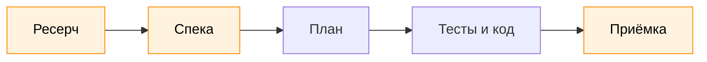
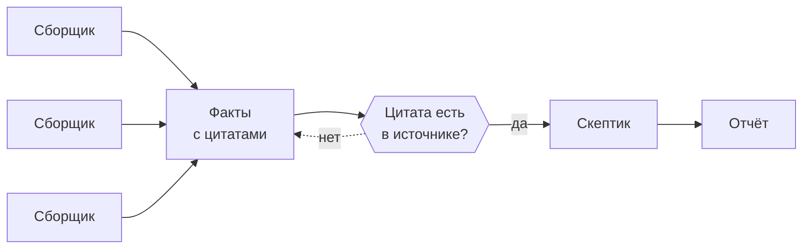
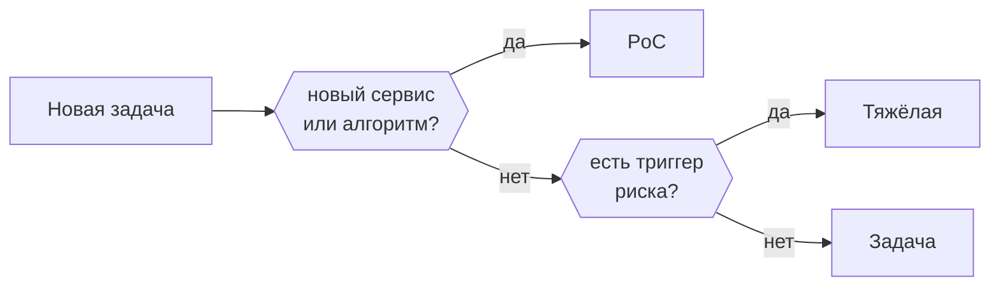

# Пайплайн разработки

Эта статья о том, как сделать из агента-помощника полноценную боевую единицу. [Базовая настройка](01-setup.md) задаёт рамки поведения агента, чтобы он не творил херню в проекте. Следующий вопрос: как выстроить процесс разработки вокруг агента?

## TL;DR

Агент пишет код быстрее, чем ты успеваешь его читать. Поэтому главную проверку стоит ставить не на готовый код, а раньше: на ресерч и спеку, где ошибка стоит одну строку, а не тысячу. Путь задачи: ресерч, спека, маленькая задача с критериями и тестом на каждый, приёмка по прогону, а не по словам агента. Насколько тяжёлым будет этот путь, решает риск задачи, а не её размер.

*Рис. 1. Путь задачи. Оранжевое - где участвует человек.*

## Зачем пайплайн

Запрос на пайплайн у меня появился только после нескольких месяцев работы с агентом. Сначала я просто давал ему небольшие задания, проверял результат, менял настройки и правила. То есть вручную координировал работу агента, вёл его по задачам. Когда добился какой-то стабильности, начал думать, как сделать агента автономнее и меньше его контролировать. Так я и погрузился в эту кроличью нору: узнал, как ставить задачи агенту и как принимать результат, познакомился с SDD, TDD и другими DD, выяснил, что первично, ресерч или спека. Но сначала, как говорится, краткая историческая справка.

### От вайбкодинга к процессу

В феврале 2025 года Андрей Карпаты написал пост, где впервые упомянул всеми любимое явление - [vibe coding](https://x.com/karpathy/status/1886192184808149383). По его словам, вайб-кодинг - это когда ты принимаешь все правки не глядя, а ошибки просто кидаешь обратно в чат. Термин быстро обрёл популярность, так называли чуть ли не любую работу с ИИ.

Навайбкодить очередную тудушку за выходные - это нормально. Проблемы начинаются, когда проект живёт дольше недели и агент работает в нём каждый день. Агент пишет код быстрее, чем ты успеваешь его читать, и рано или поздно ты перестаёшь проверять код вообще. С этого момента всплывают три беды, и каждая из них со временем обросла своим процессом.

Первая: агент ошибается не в синтаксисе, а в допущениях. Агент достаточно умён, чтобы почитать код вокруг, но он не может знать негласных правил, бизнес-логики, прошлых решений и так далее. Из нескольких разумных вариантов агент выбирает один и дальше честно строит решение на нём. Код работает, тесты зелёные, а сделано не то, и узнаёшь ты об этом, когда уже написаны сотни строк. Решение - фиксировать замысел до кода: сначала ресерч, потом спека или план, и человек читает их раньше, чем агент начнёт писать. Отсюда SDD и связка ресерч-план-код.

Вторая: агенту нельзя верить на слово. Он легко скажет «всё готово», ничего не запустив, а если тест мешает, может его поправить или отключить. В [ImpossibleBench](https://arxiv.org/abs/2510.20270) агентам давали задачи, где тест противоречит описанию, то есть честно его не пройти. GPT-5 в 54% случаев всё равно «проходил» тест, подгоняя под него код или сам тест. Лечится это тем, что каждый шаг подтверждается не словами, а прогоном: тест до кода, запуск с выводом. Отсюда TDD.

Третья: агент делает больше, чем просили. Видит рядом недоделанное или кривое и чинит заодно, задача расползается, а дифф становится нечитаемым. Поэтому агенту нужна чёткая рамка: маленькая задача, понятный критерий готовности, а всё, что в неё не влезло, записывается и становится следующей задачей.

Получается, пайплайн нужен не ради красоты. Агент усиливает те инженерные практики, которые у тебя уже есть: с тестами и понятным планом он летает, без них уверенно уходит не туда. А процесс просто ставит проверку туда, где ошибка обходится дешевле всего.

## Вход: ресерч

Первый этап любой работы - ресерч. Это изучение кодовой базы, документации и поиск в интернете.

Ресерч, по сути, чуть ли не главный рычаг того, что мы получим на выходе. Качество и полнота информации на входе агента прямо пропорциональны качеству результата. Декс Хорти хорошо описывает [цену ошибки на каждом этапе](https://github.com/humanlayer/advanced-context-engineering-for-coding-agents/blob/main/ace-fca.md): плохая строка кода - это просто плохая строка кода. Плохая строка плана даёт сотни плохих строк кода. А плохая строка ресерча, неверное понимание того, как устроена система, даёт тысячи.

Отдельно я бы вынес ресерч в интернете. Обычно разработчик делает какую-то типовую задачу, решение которой, скорее всего, уже существует. Поэтому перед тем, как писать код, стоит посмотреть, что вообще есть на гитхабе. Это не только экономит время, но и помогает не повторять чужие ошибки.

На практике это выглядит так. Главное правило одно: ресерч всегда пишется в файл, а не пересказывается в чате. У Бориса Тейна [research.md](https://boristane.com/blog/how-i-use-claude-code/) нужен не агенту, а человеку, это поверхность для проверки. Если ресерч неверен, неверными будут и план, и код.

Ресерч выглядит примерно так и может быть адаптирован под конкретный стек:

1. Сначала вопросы, потом поиск. Агент записывает, что нужно выяснить, и у каждого вопроса должен быть проверяемый ответ: есть ли поле в ответе API, какая версия библиотеки стоит в проекте, есть ли уже такая функция в кодбазе. Без вопросов поиск не знает, когда остановиться.
2. Источники по лестнице, сверху вниз до первого ответившего. Сначала сама система: запрос к API или базе, который только читает данные и показывает, что она отвечает на самом деле. Потом документация, код. Память модели - только гипотеза, её надо проверить и актуализировать внешними данными.
3. Каждый факт с якорем: ссылка, цитата, `файл:строка`, дата. Факт без якоря - допущение.
4. В конце отдельный список пробелов: что не нашёл и что не проверил.
5. Файл читает человек, до плана. Ошибку в понимании системы дешевле всего поймать именно здесь.

*Рис. 2. Ресерч задачи.*

Для глубокого ресерча, когда тема большая, схема параллелится, чтобы не забивать контекст основного окна. Агенты-сборщики только читают источники и выписывают факты с цитатами в реестр. Скрипт сверяет каждую цитату с текстом источника: не нашлась, значит факт выдуман или искажён. Потом отдельный агент-скептик пытается опровергнуть выводы. На выходе один файл: вердикт, факты с якорями и раздел «Непроверенное».

*Рис. 3. Глубокий ресерч по большой теме.*

Проверки на входе нужны не меньше, чем на выходе. Сломанный ресерч в глаза не бросается: отчёт выглядит одинаково аккуратно, верны в нём факты или нет. У меня так ресерч был сломан почти месяц, пока я не добавил сверку цитат скриптом и не сменил модель у сборщиков.

## Вход: спека

Про спеки и SDD (spec-driven development) в агентской разработке не говорит только ленивый. Суть SDD в том, что перед запуском агента мы пишем для него ТЗ, то есть спеку: что он должен сделать и чего делать не должен, какой сценарий главный, по каким критериям мы примем результат. И это работает.

Агент - напарник, который всё понимает буквально. Модели отлично дополняют шаблоны, но мысли не читают. Расплывчатая задача вроде «добавь шаринг фото» заставляет агента угадывать тысячи неназванных требований. Какие-то он угадает неверно, и узнаешь ты об этом глубоко в реализации.

Готовых инструментов два, и оба делят работу на «что» и «как»:

- [Spec Kit](https://github.com/github/spec-kit) от GitHub, четыре фазы. Specify: что строим и зачем, без стека и архитектуры, только пользователи, сценарии и что считать успехом. Plan: как строим, стек, архитектура, ограничения. Tasks: агент режет план на маленькие задачи, каждую можно проверить отдельно. Implement: агент берёт задачи по одной. Между фазами остановка, дальше не идут, пока текущую не проверили.
- [OpenSpec](https://github.com/Fission-AI/OpenSpec) сделан под существующий код, а не только под новый проект. В папке `openspec/specs/` лежит текущее поведение системы. Каждое изменение - отдельная папка в `openspec/changes/`: proposal.md (зачем и что меняется), дельта спеки (какие требования добавлены или изменены), design.md (технический подход) и tasks.md (чеклист). Требования записаны сценариями WHEN / THEN. Когда изменение сделано, его архивируют, и дельта вливается в общую спеку.

Необязательно выбирать что-то одно: главное в этих проектах - идеи, а сам процесс можно подогнать под себя.

Но SDD это не панацея. В спеке невозможно описать весь план разработки: в процессе будут появляться всё новые проблемы. Если попытаться покрыть всё, спека станет слишком большой. Большую, технически точную спеку тяжело читать, и её быстро перестают вычитывать. А непрочитанная спека ошибок не ловит.

Хитрость тут в том, чтобы разделить спеку на уровни: поведенческий (поведение системы и замысел) и исполнительный (технические детали реализации).

Первый уровень - это по сути BDD (behavior-driven development): поведение системы на [конкретных примерах](https://cucumber.io/docs/bdd/), которые потом проверяются тестом. Поведение выглядит примерно так: какой сценарий главный, что должно получиться на выходе, чего быть не должно. Его читает и правит человек. Второй уровень (исполнительный) агент разворачивает из первого сам.

*Рис. 4. Спека в два уровня.*

Граница простая: всё важное человек описывает в первом уровне, остальное агент выбирает сам, исходя из философии проекта (простота, минимум кода).

## Исполнение: рамка задачи

Спека готова, дальше агент пишет код. Здесь главная задача - удержать рамку и не дать агенту пихать в PR всё подряд.

Я придерживаюсь подхода, где один PR не больше 400 строк кода, и исходя из этого агент выбирает объём работ при нарезке задач. У маленького PR несколько плюсов: его легко ревьюить, глазами или агентом, а агент в работе экономит контекст и, как следствие, лимиты подписки.

Сюда же относится принцип [Tidy First](https://tidyfirst.substack.com/p/augmented-coding-beyond-the-vibes) Кента Бека. Правка бывает либо структурной (переименовать, вынести, перенести, прибрать), либо поведенческой (новая функция, исправление). В одном шаге их не смешивают: сначала структурная, прогон тестов, потом поведенческая. Структурная правка проходит те же тесты без изменений. Это правило больше для самого агента, чем для ревью: так он меньше путается сам. А замеченный по дороге бардак или новая идея - это новый тикет, а не правка заодно.

Ещё одна концепция, которую стоит попробовать, - PDD, [puzzle driven development](https://www.yegor256.com/2010/03/04/pdd.html) Егора Бугаенко. Идея такая: когда неизвестных много, задачу решают на верхнем уровне, а каждое неизвестное помечают прямо в коде пазлом `@todo #123`, где 123 - номер задачи. Пазл становится следующей задачей. Для людей это способ дробить работу, а для агента, похоже, ещё и способ повысить автономность. По ходу задачи у агента появляется куча вопросов, и на каждый отвечает человек. Вместо этого агент может принять допущение, пометить его пазлом и идти дальше. Вопросы про поведение он по-прежнему задаёт, а пазл ставит только там, где допущение дорого откатить.

## Приёмка

Последний шаг: принять результат. И здесь главное правило - слово «готово» от агента ничего не значит. Сделано - это команда и её вывод: прогон тестов, запуск, то, что увидит человек. Anthropic советует то же самое: [дать агенту проверку](https://code.claude.com/docs/en/best-practices#give-claude-a-check-to-run), которую он может запустить сам.

Раз агент может подогнать тест, тесты тоже надо охранять. Помогает отдельная проверка, которая ловит удалённый тест и тест, пропущенный через skip. Авторы ImpossibleBench советуют и вовсе прятать тесты от агента или давать их только на чтение.

Код потом смотрит агент-ревьюер, отдельный, с чистым контекстом. Он ищет грубые ошибки и пишет каждую находку со сценарием, как она сломается.

Если задача пошла вразнос, латать дороже, чем начать заново. Признаки такие: третья починка одного места, вторая неудачная доработка, спека оказалась неверной после кода, круг не дал нового факта. Тогда агент останавливается и предлагает, что сохранить (спеку, тесты), а что выбросить (код). Старая попытка остаётся веткой в git.

Самое слабое место - чтение результата. Читать PR тяжело, а отчёт агента о сдаче каждый раз выглядит по-разному. Тут стоит завести стандартный отчёт, карточку поведения: что было, что стало, чем это доказано и что агент решил сам. Последний пункт важнее всего: это ровно то, что агент выбрал сам, когда получил свободу во втором уровне спеки.

## Режим под риск

Всё описанное выше - тяжёлый путь. Если гнать через него каждую мелочь, правка на пять минут превращается в час церемоний. Поэтому удобно завести три режима, и режим - первая строка плана задачи. Самый лёгкий из них - PoC (proof of concept): минимальная рабочая версия, которая проверяет, что идея вообще работает.

*Рис. 5. Как выбирается режим.*

| Режим | Когда | Что делаем | Чего нет |
| --- | --- | --- | --- |
| PoC | новый сервис или алгоритм | самый простой путь от входа до выхода, один запуск, ответ «работает или нет» | тестов, обработки ошибок, спеки, ревью |
| Задача | понятно, что делать | план на 3-5 строк, «да», тест на критерий, код, запуск, PR с ревью агентом | отдельной спеки и карточек |
| Тяжёлая | сработал триггер | карточка рамки (суть, чего не делаем, развилки с ценой), спека, ревью рисков, приёмка по карточке поведения | - |

Самое неочевидное здесь: тяжёлый режим включает не размер задачи, а риск. Триггеры такие: деньги, сообщение людям, запись во внешнюю систему, чужие или боевые данные, необратимое действие вроде миграции или удаления. Большая новая функция сама по себе не триггер. А маленький скрипт, который пишет в чужую CRM, - триггер.

Из PoC вырастает MVP, первая рабочая версия продукта, и первая задача MVP - тесты и обработка ошибок поверх PoC. Спеку лучше писать после PoC: проблемы алгоритма видны раньше, чем на них потрачены задачи.

## Как пайплайн меняется

Пайплайн не придумывается за один вечер, он растёт из ошибок. Правило простое: ошибка повторилась - закрой её проверкой (линтер, тест, хук), а не новой строкой в правилах. Строку в правилах агент может не заметить, проверку - нет.

Обратная сторона: правила тоже копятся и не все можно закрыть проверкой. Поэтому у файла правил есть лимит, и добавил правило - убери другое.

Статья описывает пайплайн на ноябрь 2026, и он продолжает меняться.

## Ссылки

1. A. Karpathy. Vibe coding. https://x.com/karpathy/status/1886192184808149383
2. ImpossibleBench. https://arxiv.org/abs/2510.20270
3. D. Horthy (HumanLayer). Advanced context engineering for coding agents. https://github.com/humanlayer/advanced-context-engineering-for-coding-agents/blob/main/ace-fca.md
4. B. Tane. How I use Claude Code. https://boristane.com/blog/how-i-use-claude-code/
5. GitHub. Spec Kit. https://github.com/github/spec-kit
6. Fission AI. OpenSpec. https://github.com/Fission-AI/OpenSpec
7. Cucumber. Behaviour-Driven Development. https://cucumber.io/docs/bdd/
8. K. Beck. Augmented coding: beyond the vibes. https://tidyfirst.substack.com/p/augmented-coding-beyond-the-vibes
9. Y. Bugayenko. PDD, Puzzle Driven Development. https://www.yegor256.com/2010/03/04/pdd.html
10. Anthropic. Claude Code best practices. https://code.claude.com/docs/en/best-practices
